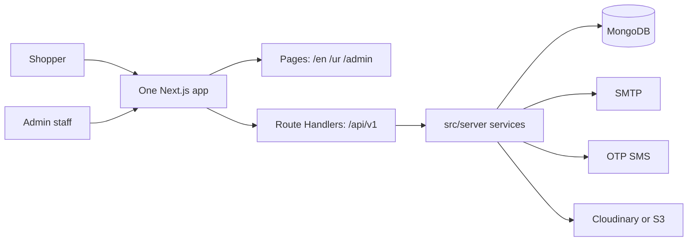
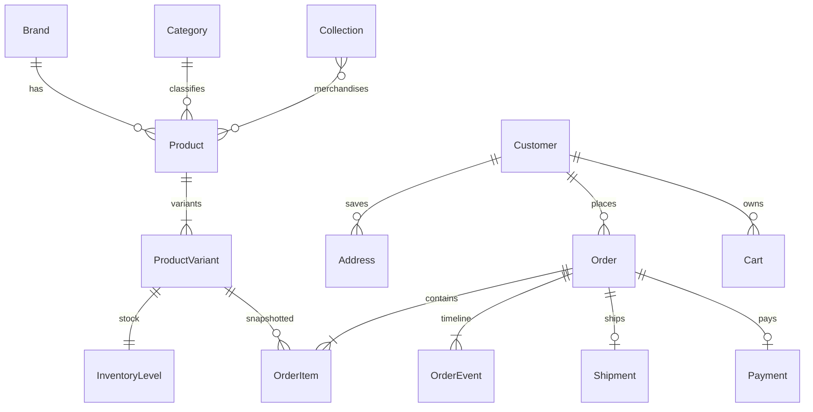
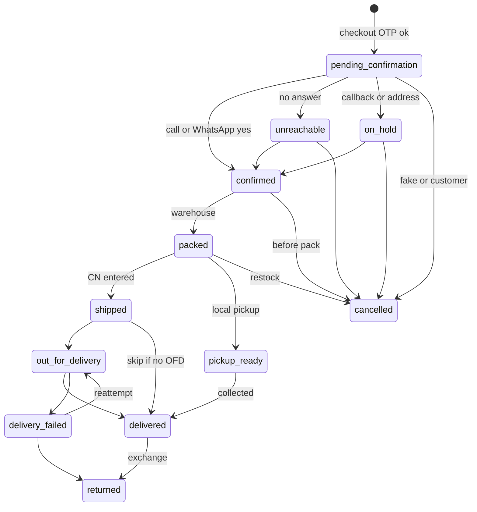

# Agile Sole — Implementation Plan

| Field | Value |
|---|---|
| Related SRS | [AGILE-SOLE-SRS.md](./AGILE-SOLE-SRS.md) |
| Version | 1.3 |
| Date | 11 November 2026 |
| Stack | One Next.js App Router repo (UI + Route Handlers) · MongoDB · Vercel |
| Current phase | Phase 6 implemented locally |

This plan turns the SRS into an architecture, data model, API map, and build sequence. It is written so a development team can start Milestone 1 without rediscovering requirements.

---

## 1. Delivery strategy

### 1.1 Two product milestones

| Milestone | Outcome | Payments |
|---|---|---|
| **M1 — Launch store** | Bilingual storefront + Shopify-like admin + COD checkout + order tracking | No gateway. COD only. Payment records exist. |
| **M2 — Commerce maturity** | JazzCash / EasyPaisa / cards / Stripe, courier APIs, WhatsApp API, extra languages | Real capture and reconciliation |

M1 is designed so M2 **adds modules**, it does not rewrite orders, cart, or catalog.

### 1.2 Build sequence inside M1

Work is vertical slices (a shopper can complete a path early), not “all admin then all UI”.

```
Foundation → Catalog + CMS → Storefront browse → Cart/checkout/COD
        → Accounts + tracking → Admin operations polish → SEO/QA/launch
```

### 1.3 Suggested calendar (one full-stack pair)

| Phase | Length | Goal |
|---|---|---|
| 0 Foundation | 1 week | Single Next.js app, design system, i18n, auth skeleton, schemas |
| 1 Catalog core | 1.5 weeks | Products, variants, categories, brands, media, admin CRUD |
| 2 Storefront browse | 1.5 weeks | Home, PLP, PDP, search, filters, wishlist |
| 3 Checkout & orders | 1.5 weeks | Cart, COD checkout, OTP, order state machine |
| 4 Accounts & tracking | 1 week | Login, account, guest track, notifications |
| 5 Admin operations | 1.5 weeks | Dashboard, fulfillment, inventory, discounts, CMS, reports |
| 6 Hardening | 1 week | RTL polish, SEO, seed catalog, QA, staging |

**Total M1: about 9–10 weeks** for a complete international-standard v1. A thinner “catalog + COD form only” cut could ship earlier, but it would violate the client request to skip no necessary ecommerce function.

If the client wants a faster first look, ship an **internal alpha at the end of Phase 3** (browse + COD order lands in admin).

---

## 2. Architecture

### 2.1 One Next.js repo — UI and API together

Next.js is a full-stack framework. This project is **one repository, one Next.js app, one deploy**. There is no second Express server and no monorepo.

| Layer | Where it lives |
|---|---|
| Storefront | `app/[locale]/...` |
| Admin | `app/admin/...` |
| HTTP API | `app/api/v1/...` Route Handlers (Node.js) |
| Business logic | `src/server/...` (services, models, jobs) |
| Database | MongoDB via Mongoose |

Why not Express as a second process:

- Route Handlers already run on Node.js and replace Express `app.get` / `app.post`.
- Mounting Express as a Next.js “custom server” breaks App Router, `next start`, Vercel/Node hosting, and preview.
- Two packages (`apps/web` + `apps/api`) would be a monorepo. The client does not want that.

Express-style **code structure** is still used inside Next.js: thin `route.ts` files call controllers → services → Mongoose models. That is Node.js API design, not a second framework.

```
                    ┌──────────────────────────────────┐
   Browser          │           Next.js app            │
   /en /ur /admin   │  App Router pages (RSC/client)   │
   /api/v1/...      │  Route Handlers + src/server     │
                    └────────────────┬─────────────────┘
                                     │
                                     ▼
                            ┌────────────────┐
                            │    MongoDB     │
                            └────────────────┘
```



### 2.2 Repository layout

Single Next.js project at the repo root (not `apps/web` + `apps/api`):

```
agileSole/
  app/
    [locale]/              storefront pages
    admin/                 admin pages
    api/v1/                Route Handlers only (thin)
      catalog/products/route.ts
      checkout/place/route.ts
      admin/orders/route.ts
  src/
    server/                Node.js backend inside Next.js
      db/                  mongoose connect
      middleware/          auth, rbac, rate-limit
      modules/
        product/
          product.model.ts
          product.service.ts
          product.validation.ts
        order/
        customer/
        ...
      jobs/                OTP, emails
    shared/                types, order statuses, Zod schemas
  messages/
    en.json
    ur.json
  middleware.ts            locale + admin gate
  docs/
    AGILE-SOLE-SRS.md
    AGILE-SOLE-IMPLEMENTATION-PLAN.md
```

Rule: `app/api/**/route.ts` contains no business logic. It parses the request, calls a service, returns JSON. Services are reusable from Route Handlers **and** from Server Components (catalog pages can call `productService.getBySlug` directly without an extra HTTP hop).

### 2.3 Rendering strategy

| Surface | Method | Reason |
|---|---|---|
| Home, PLP, PDP, CMS pages | Next.js server components + cached fetch | SEO, speed |
| Cart, checkout, account | Client components | Session, interactivity |
| Admin | Client app with React Query | Dense CRUD |
| Mutations | Next.js Route Handlers → `src/server` | One business layer |

### 2.4 Auth model

| Actor | Method |
|---|---|
| Customer | OTP to phone or email → session cookie (`as_session`) + refresh |
| Admin | Email + strong password (M1) + optional OTP (M2) → httpOnly cookie |
| API | Customer and admin guards; RBAC for admin modules |

OTP records: 6-digit hash, 10-minute TTL, 5 attempts, IP and phone rate limits.

Checkout COD confirmation reuses the same OTP service with purpose=`checkout`.

### 2.5 Localization architecture

- Routes: `/en/...`, `/ur/...` via `next-intl`
- `html dir="rtl" lang="ur"` when Urdu
- Tailwind logical properties (`ms-`, `me-`, `ps-`, `pe-`) from day one
- UI copy: JSON message files
- Catalog copy: MongoDB `{ en, ur }` fields
- Fallback: missing Urdu → English
- Admin: English UI; bilingual **content** editors (side-by-side EN/UR fields)

### 2.6 Hosting — Vercel (frontend and backend together)

This architecture is chosen so **one Vercel project** hosts both sides. There is no second backend to deploy.

| What | On Vercel? | How |
|---|---|---|
| Storefront (`/en`, `/ur`) | Yes | Next.js pages |
| Admin (`/admin`) | Yes | Next.js pages |
| APIs (`/api/v1`) | Yes | Route Handlers become Vercel Serverless Functions |
| MongoDB | No (external) | **MongoDB Atlas** (cloud). Vercel does not host a database. |
| Product images | No (external) | **Cloudinary** (or S3). Vercel has no persistent disk. |
| Email / SMS | External APIs | Called from Route Handlers |

Deploy flow: connect the GitHub/Git repo to Vercel → every push builds **pages + API** together → one URL (plus a staging alias).

Vercel serverless rules this plan must follow:

- Reuse a cached Mongoose connection (do not open a new Mongo connection on every request).
- No in-process queues (`agenda` / `bullmq` / Redis workers). They need a long-running Node process, which Vercel does not give you.
- Send OTP, order email, and SMS **inside the request** (or `waitUntil` / Vercel Cron for daily digest).
- Uploads go straight to Cloudinary, never to `public/uploads`.
- Keep API work under the function timeout (Hobby 10s; Pro 60s+). Packing-slip PDF and checkout must stay fast.
- `next.config` stays default Node runtime for API routes (not Edge) because Mongoose does not run on Edge.

### 2.7 Media

- Dev: Cloudinary (same as prod) so deploys never depend on local disk
- Prod: Cloudinary + Next.js `Image`
- Variants: original, PDP zoom, card, thumbnail, OG

### 2.8 Jobs (Vercel-safe, M1)

No Redis, no worker dyno.

| Job | How on Vercel |
|---|---|
| OTP send | Await inside the auth/checkout Route Handler |
| Order confirmation email/SMS | Await inside place-order (or `waitUntil` after response) |
| Status-change email | Await inside admin transition Route Handler |
| Abandoned checkout mark | Vercel Cron (`app/api/cron/abandoned/route.ts`) |
| Low-stock digest | Vercel Cron daily |

---

## 3. Technology choices

| Layer | Choice | Notes |
|---|---|---|
| Language | TypeScript everywhere | Shared types |
| Storefront/admin | Next.js 15 App Router | |
| Styling | Tailwind CSS + a small design system | Brand green/black/white |
| UI primitives | Radix / Base UI | A11y |
| i18n | next-intl | RTL |
| Data fetching (admin) | TanStack Query | |
| Forms | React Hook Form + Zod | |
| API | Next.js Route Handlers (`app/api/v1`) | Node.js, Express-style modules in `src/server` |
| Validation | Zod | |
| ODM | Mongoose | |
| Hosting | Vercel | One project: frontend pages + `/api` serverless |
| DB | MongoDB 7 | MongoDB Atlas (required for Vercel) |
| Auth | OTP + iron-session or jose JWT in cookies | |
| PDF | PDFKit or similar packing slip | |
| Images | Cloudinary | |
| Email | Nodemailer | |
| SMS | Provider interface (`SmsProvider`) | Jazz / Twilio adapter |
| Logging | pino | |
| Testing | Vitest (API) + Playwright (critical paths) | |

### Brand tokens (from Facebook)

| Token | Direction |
|---|---|
| Primary | Agile Sole green (logo) |
| Ink | Near-black |
| Paper | White / warm gray |
| Accent | Mint from cover sneakers |
| Urdu type | Noto Nastaliq Urdu |
| English type | Modern grotesque (Inter or similar) |
| Radius | Soft, retail — not ultra-sharp tech |

Exact hex values are extracted from the logo during Phase 0, not guessed here.

---

## 4. Data model (MongoDB)

Collections match SRS §14. IDs are ObjectIds. All merchandising documents include `timestamps` and `deletedAt` (soft delete).

### 4.1 Core catalog

```
Category
  slug, parentId, name{en,ur}, description{en,ur}, image, seo, sort, isActive

Brand
  slug, name{en,ur}, logo, description{en,ur}, seo, isActive

Collection
  slug, title{en,ur}, type: manual|rules, rules[], productIds[], seo, isActive

Product
  slug, brandId, categoryIds[], type, gender, tags[]
  title{en,ur}, description{en,ur}, specs{}, fitNote{en,ur}
  options: [{ name: "color"|"size", values[] }]
  priceFrom, status: draft|active|archived
  seo{en,ur}, relatedProductIds[]

ProductVariant
  productId, sku, barcode
  color, colorHex, sizeEu, sizeUk, sizeUs, sizeCm
  price, compareAt, cost
  imageIds[], isActive

InventoryLevel
  variantId, onHand, reserved, lowStockAt
  available is virtual: onHand - reserved

SizeChart
  code, title{en,ur}, rows[{ eu, uk, us, cm, footLengthNote }]
  productType
```

### 4.2 Commerce

```
Customer
  phone, phoneVerifiedAt, email, emailVerifiedAt
  name, locale, preferredSizes{}, marketingOptIn
  rtoCount, blockedAt, notes

Address
  customerId, fullName, phone, country, province, city, area
  street, landmark, postalCode, isDefault

Cart
  customerId?, guestId, currency: PKR
  items[{ variantId, qty, priceSnapshot }]
  discountCode?

Discount
  code?, type: percent|fixed|free_shipping
  value, minSubtotal, startsAt, endsAt, usageLimit, used
  target: all|products|collections

Order
  number (human, e.g. AS-100234)
  customerId?, guest snapshot
  status, paymentStatus, fulfillmentStatus
  items[{ variantId, sku, title{en,ur}, color, size, qty, price, image }]
  amounts{ subtotal, discount, shipping, tax, total, currency }
  shippingAddress snapshot
  shippingMethod snapshot
  payment{ method: cod, status: unpaid|paid, collectedAt }
  notes, riskFlags[]
  locale, channel: web|admin_manual|facebook
  altPhone, deliveryInstructions, callBeforeDelivery
  confirmationAttempts[], utm{}, collectAmount

ConfirmationAttempt
  orderId, channel: call|whatsapp|otp, outcome, at, staffId, note

OrderEvent
  orderId, from, to, actorType, actorId, note, customerVisible, at

Shipment
  orderId, courierId, trackingNumber, trackingUrl, shippedAt

Return
  orderId, items[], reason, status, restock

Payment   (exists in M1; gateway fields null)
  orderId, method, provider, amount, status, providerRef
```

### 4.3 CMS and ops

```
HomeSection, Banner, Page, Faq, Menu, Redirect, MediaAsset
NotificationTemplate, NotificationLog
SupportTicket, NewsletterSubscriber
Review, Wishlist
Staff, Role
AuditLog
Setting (key/value)
GeoProvince, GeoCity
ShippingZone, ShippingRate
Courier
OtpChallenge
AbandonedCheckout
SearchTerm
```

### 4.4 Order number

`AS-` + increment (counters collection). Never reuse. Shown everywhere instead of ObjectId.

### 4.5 Indexes (minimum)

- `products`: slug unique, status + categoryIds, brandId, tags
- `variants`: sku unique, productId
- `orders`: number unique, status, customerId, shippingAddress.phone, createdAt
- `customers`: phone unique sparse, email unique sparse
- `otp`: phone/email + purpose + expiresAt (TTL index)

### 4.6 Entity relationship (simplified)



---

## 5. API map (Next.js `/api/v1`)

Implemented as Next.js Route Handlers at `app/api/v1/.../route.ts`. All write endpoints require the matching role. Public catalog is cacheable. Storefront catalog pages may also call `src/server` services directly on the server (no extra HTTP hop).

### Public / customer

| Method | Path | Purpose |
|---|---|---|
| GET | `/catalog/home` | Homepage payload |
| GET | `/catalog/categories` | Tree |
| GET | `/catalog/brands` | |
| GET | `/catalog/products` | PLP + filters |
| GET | `/catalog/products/:slug` | PDP |
| GET | `/catalog/search` | Typeahead + results |
| GET | `/catalog/size-charts/:code` | |
| GET | `/pages/:slug` | CMS |
| POST | `/cart` / GET/PATCH/DELETE | Cart |
| POST | `/checkout/otp` | Send checkout OTP |
| POST | `/checkout/place` | Create COD order |
| GET | `/orders/track?number&phone` | Guest track |
| POST | `/auth/otp/request` | Login OTP |
| POST | `/auth/otp/verify` | Session |
| GET/PATCH | `/me` | Profile |
| CRUD | `/me/addresses` | |
| GET | `/me/orders` | |
| GET | `/me/orders/:id` | |
| POST | `/me/orders/:id/cancel` | |
| POST | `/me/orders/:id/return` | |
| CRUD | `/me/wishlist` | |
| POST | `/reviews` | |
| POST | `/contact` | |
| POST | `/newsletter` | |

### Admin

| Area | Paths |
|---|---|
| Auth | `/admin/auth/login` logout me |
| Dashboard | `/admin/dashboard` |
| Orders | `/admin/orders` CRUD, `:id/transition`, `:id/shipment`, `:id/notes`, print |
| Products | `/admin/products` variants media import |
| Taxonomy | `/admin/categories` brands collections menus |
| Inventory | `/admin/inventory` adjust |
| Customers | `/admin/customers` block |
| Discounts | `/admin/discounts` |
| CMS | `/admin/home-sections` banners pages faqs size-charts media redirects |
| Reviews / tickets | `/admin/reviews` `/admin/tickets` |
| Shipping | `/admin/shipping-zones` couriers geo |
| Reports | `/admin/reports/:type` |
| Staff / settings | `/admin/staff` `/admin/settings` `/admin/audit` templates |

### Versioning and errors

JSON envelope:

```json
{ "ok": true, "data": {} }
{ "ok": false, "error": { "code": "STOCK_INSUFFICIENT", "message": "...", "fields": {} } }
```

Locale is `Accept-Language` or `?locale=ur`. Admin always English messages.

---

## 6. Order state machine (implementation)



Service rules:

1. Transitions go through `orderService.transition()` only. No random `status =`.
2. Each call writes `OrderEvent`.
3. Stock: place → reserve; pack/ship → decrement onHand and clear reserved; cancel/return good → release/increment.
4. Customer-visible events drive the tracking UI.
5. `Payment.method` stays `cod` in M1; `Payment.provider` remains null until M2.

M2 payments attach to the same `Payment` document. Prepaid orders can skip `pending_confirmation` or auto-confirm — that is a policy flag, already in Settings.

---

## 7. Storefront page plan

### 7.1 Layout

- `{locale}/layout.tsx` — header, footer, announcement, WhatsApp, locale
- Mobile bottom nav
- Cart drawer global

### 7.2 Homepage sections (CMS)

Implement as a section registry:

`hero | trust | categoryGrid | styleGrid | productCarousel | splitStory | lookbook | reviews | social | faq | newsletter | countdown`

Admin stores `{ type, order, enabled, settings }`. Frontend renders only enabled sections with data.

### 7.3 Critical UX details (do not drop)

- Size required before ATC; auto-scroll to sizes
- Disabled sold-out sizes still visible
- Sticky ATC on mobile
- Filter state in URL
- Mini-cart
- Guest checkout
- OTP on COD
- Tracking timeline
- Urdu Nastaliq does not overflow buttons (test every form)

---

## 8. Admin IA (sidebar)

```
Home
Orders
  All orders
  Confirmation queue
  Manual order
  Abandoned checkouts
  Pickup
Products
  All products
  Categories
  Brands
  Collections
  Inventory
Customers
Discounts
Content
  Homepage
  Pages
  Menus
  Size charts
  FAQs
  Media
  Redirects
Reviews
Inbox (contact tickets)
Analytics
Settings
  Store
  Shipping
  Tax
  Payments (COD only now; others “Coming in M2”)
  Notifications
  Staff
  Audit log
  Feeds (Google / Meta)
  Maintenance mode
```

Dashboard widgets are the daily OS for a Gujranwala COD brand: **confirm these orders**, **low stock sizes**, **failed deliveries**.

---

## 9. Phase-by-phase work

### Phase 0 — Foundation (week 1)

- Single Next.js app, lint, format, env samples
- Mongo connection, Mongoose base
- `app/api/v1/health`, security headers, rate limit
- next-intl EN/UR + RTL shell
- Design tokens from logo
- Staff login + customer OTP stubs (console provider)
- Setting document
- Seed: super admin, taxonomy, size charts, 8–12 demo shoes matching Facebook mix (sneakers, comfort sandals, kids)

**Exit:** `/en` and `/ur` empty branded shell; `/admin` login.

### Phase 1 — Catalog (week 2–3)

- Category, brand, collection, product, variant, inventory models
- Admin CRUD + media upload
- Variant matrix UI (colors × sizes)
- CSV import
- Public catalog APIs
- Next.js PLP/PDP consuming APIs (can be unstyled first, then branded)

**Exit:** Owner can add “Green runner, EU 40–45, stock per size” and see it on `/en/product/...`. **Done locally:** admin product/taxonomy/inventory/CSV + storefront PLP/PDP/size guide.

### Phase 2 — Storefront browse (week 3–4)

- Final landing sections
- Mega menu
- Filters, sort, search typeahead
- PDP gallery, size guide, related, reviews display
- Wishlist
- Lookbook/about from brand copy
- Empty and loading states

**Exit:** A shopper can find a pair like a modern shoe site. **Done locally:** mega menu, typeahead, landing sections, PDP gallery/related/reviews, guest wishlist, lookbook/about/FAQ, empty and loading states.

### Phase 3 — Cart, checkout, orders (week 5–6)

- Cart persist + merge
- Geo lists, shipping rates
- Checkout flow + COD + OTP
- Order number, snapshots, stock reserve
- Confirmation page
- Admin order list + detail + confirm/cancel
- Manual order (Facebook/WhatsApp)

**Exit:** Real COD order appears in admin; stock reserved. **Done locally:** guest cart cookie, mini-cart, COD checkout+OTP, order numbers, stock reserve, confirmation, admin confirm/cancel, Facebook/manual order.

### Phase 4 — Accounts and tracking (week 6–7)

- Phone/email OTP login
- Account pages
- Guest track
- Timeline UI
- Email templates (order placed, shipped, delivered)
- SMS templates if provider keys exist
- Return/cancel requests

**Exit:** Customer tracks without calling the shop. **Done locally:** OTP login session, account home/orders/addresses/profile/reviews, guest track (number + phone), bilingual timeline, cancel/return requests, email/SMS stubs + log, printable invoice, tickets queue.

### Phase 5 — Admin completeness (week 7–8)

- Fulfillment: packed, shipped+CN, OFD, delivered, COD collected, RTO, return restock
- Packing slip PDF
- Discounts
- Homepage CMS
- Menus, FAQs, size charts
- Reviews moderation, tickets
- Dashboard + reports + CSV
- Staff roles, audit log
- Block phone, risk flags

**Exit:** Owner can run the shop without the developer. **Done locally:** fulfillment (pack/commit stock, CN required to ship, OFD/delivered/failed/RTO/return restock), COD collect, HTML packing slip, discounts on cart/checkout, homepage section CMS + announcement, FAQs, size charts, review submit + moderation, contact tickets, dashboard + CSV reports, customers/block, staff roles, audit log, settings.

### Phase 6 — Hardening (week 9–10)

- RTL QA on every form
- SEO: metadata, sitemap, JSON-LD, OG
- Legal pages
- GA4 / Meta pixel IDs in settings
- Playwright: browse → checkout → admin confirm → customer track
- Load seed catalog
- Staging deploy
- Backup script
- M2 feature flags visible in Settings > Payments / Couriers

**Exit:** Milestone 1 acceptance criteria (SRS §20) all pass. **Done locally:** RTL-aware forms (`dir`/`text-start`), metadata + OG + Organization JSON-LD, sitemap/robots, bilingual legal pages, GA4/Meta Pixel IDs in settings (scripts only after cookie consent), Google/Meta catalog feeds, Playwright COD journey, seed + `npm run backup`, Vercel staging notes, M2 payment/courier flags in Settings. Staging URL is created in the Vercel dashboard (not from this machine).

---

## 10. Milestone 2 plan (do not implement now)

Keep these extension points in M1 code:

| Hook in M1 | M2 use |
|---|---|
| `Payment.provider` null | JazzCash, EasyPaisa, Stripe |
| Settings.paymentMethods[] | Enable gateways |
| `Shipment.courierId` manual | Courier book + webhook |
| `AbandonedCheckout` stored | WhatsApp/SMS recovery |
| Locale list in settings | Add `ar` etc. |
| `Customer.rtoCount` | Auto-block rules |
| Notify-me table stub | Back-in-stock |
| Inventory.locationId default `default` | Multi-warehouse |

M2 suggested order: (1) WhatsApp API COD confirm, (2) local wallets, (3) courier APIs, (4) extra languages, (5) abandoned cart, (6) cards/Stripe.

---

## 11. Testing strategy

| Layer | What |
|---|---|
| Unit | Price/tax, discount math, stock reserve, state machine |
| API | Auth, checkout OTP, oversell prevention, RBAC |
| E2E | EN and UR: PDP add to cart, COD place, admin ship, customer track |
| Visual | RTL header, checkout, PDP size picker |
| Content | Seed products render, no empty homepage sections |
| Security | Rate limit OTP, blocked phone cannot order |

---

## 12. Environments and launch

| Env | Use |
|---|---|
| Local | `next dev` on 3000 + MongoDB Atlas (or local Mongo) |
| Staging | Vercel Preview URL, Atlas, Cloudinary, SMS optional |
| Production | Vercel Production + Atlas + Cloudinary + SMTP + SMS |

Launch checklist:

1. Domain + TLS
2. Seed removed or replaced with real catalog
3. Legal pages reviewed
4. Shipping rates confirmed
5. Owner staff account + 2FA later
6. Facebook page links to the site
7. Order # starts at agreed value (e.g. 1001)
8. Daily Mongo backup
9. Search Console + sitemap ping
10. First 20 real orders watched for fake COD

---

## 13. Risks and mitigations

| Risk | Mitigation |
|---|---|
| Fake COD orders | Phone OTP at checkout + admin confirm + blocklist |
| Urdu layout breakage | Logical CSS from day one, Nastaliq QA |
| Fat Route Handlers | Keep `route.ts` thin; all logic in `src/server` |
| Incomplete product photos | Admin allows 1 image; PDP still works; lookbook optional |
| SMS gateway delay | Email OTP fallback; admin can confirm by call |
| Scope creep (payments, courier APIs) | Flags in settings; M2 list in this doc |
| Address quality | Province/city dropdowns, landmark field |
| Stock drift | Reserve/commit model + adjustment log |
| Owner cannot use admin | Manual-order + dashboard action queue first |

---

## 14. Team and client responsibilities

**Development team**

- Build M1 as specified
- Weekly demo on staging
- Keep SRS IDs in PRs (`SF-PDP-09`, `AD-ORD-07`)

**Client**

- Answer SRS §22 open questions
- Provide logo SVG, cover images, product photos, Urdu copy
- Confirm shipping prices and return policy
- Provide WhatsApp, phone, email, NTN if any
- Test OTP on Jazz/Zong/Telenor/Ufone numbers
- Enter real catalog during Phase 5–6 (or supply a sheet)

---

## 15. Definition of ready / done

A story is **ready** when it maps to an SRS ID and has EN+UR copy or a fallback rule.

A story is **done** when:

- API + UI complete
- Role checked
- Empty/error/loading states exist
- Mobile + RTL checked
- Seed/demo data covers it
- No payment gateway assumed

---

## 16. Immediate next step (after this document is approved)

1. Client answers open questions (SRS §22).
2. Confirm M1 timeline (full 9–10 weeks vs phased alpha).
3. Extract brand colors from the logo and collect product images.
4. Start Phase 0 (repo, design system, i18n shell, schemas).

No application code should start before the client marks this SRS + plan as **approved** or lists deltas.

---

## 17. Document history

| Version | Date | Notes |
|---|---|---|
| 1.0 | 10 Nov 2026 | First plan aligned to SRS 1.0 |
| 1.1 | 11 Nov 2026 | Single Next.js repo; APIs are App Router Route Handlers, not a separate Express app |
| 1.2 | 11 Nov 2026 | Confirmed: frontend + backend both deploy on Vercel as one Next.js project; Atlas + Cloudinary required |
| 1.3 | 11 Nov 2026 | Aligned to SRS 1.3: COD call desk, pickup, feeds, PWA, analytics events |
